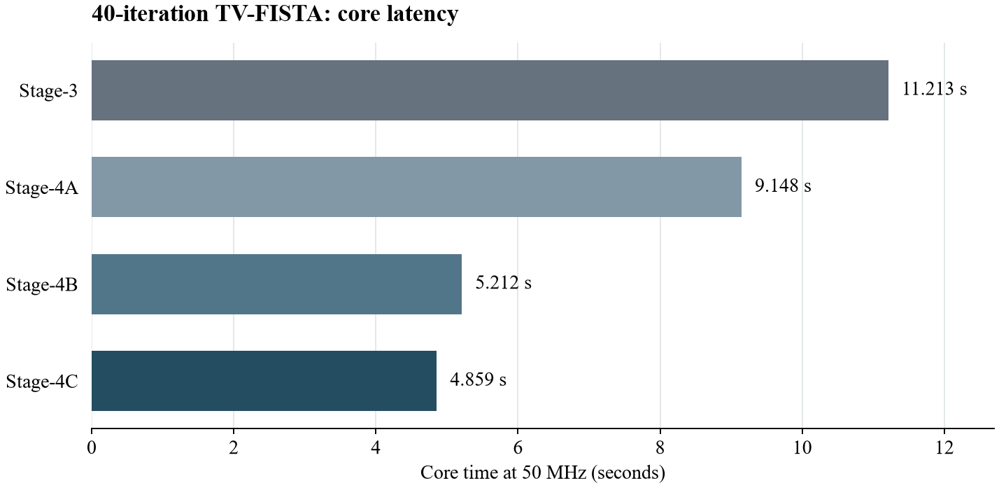
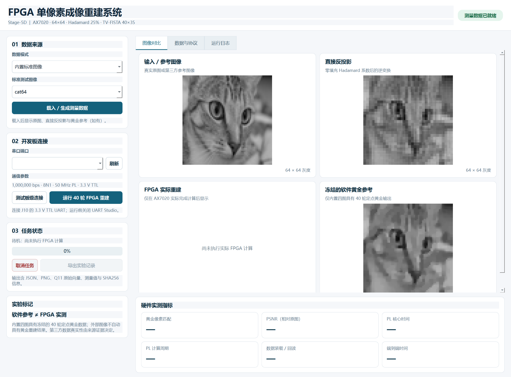

# 基于 FPGA 的压缩单像素成像与 TV-FISTA 迭代重建加速系统

高性能计算单元课程项目。单像素成像用序列化的空间编码测量替代逐像素探测；在欠采样时，利用图像梯度的稀疏性约束恢复。项目把 **64×64 灰度图、25% Hadamard 测量、40×35 轮 TV-FISTA** 的重建放在 AX7020 的 PL 上运行，并用板端逐像素读回验证其定点行为。当前项目中的测量来自数字图像的模拟编码，**没有自建真实光学采集链路**。

**English:** An FPGA accelerator for compressive single-pixel image reconstruction on the ALINX AX7020. The PL runs fixed-point TV-FISTA from digitally synthesized Hadamard measurements. Four physical-board reconstructions match their software fixed-point golden outputs bit for bit.

## 系统架构与算法

```text
图像 → PC 生成测量（或导入兼容测量）→ UART LOAD/START
    → FPGA PL：测量缓冲 → FISTA 外循环 → TV Prox 内循环
    → UART READ → Python CLI / GUI → 图像、周期数、黄金比对
```

- 将 64×64 图像按行展开为 4096 点，`W = H₄₀₉₆ / 64`（Sylvester 自然序）；`M` 按冻结的 low-sequency 掩码选 1024 点，`A = MW`，输入为 `y = Ax`。RTL 复用 4096 点 FWHT 计算正变换与伴随变换，之后算术右移 6 位。
- 重建目标为 `minₓ ½ ‖Ax − y‖₂² + λ TV(x)`。FISTA 每轮先计算数据一致性梯度 `Aᵀ(Az − y)`，再做各向同性 TV 近端更新和 Nesterov 动量更新；外迭代 40 次，每次 TV 对偶更新 35 次。
- 图像与对偶变量为 signed Q5.11，测量与 FWHT 工作值为 signed S32.F11。已验证硬件 `λ = 20/2048`。固定掩码、动量 ROM、输入及对应黄金向量随各阶段保留，不能混用不同阶段的数值契约。
- **平台：** ALINX AX7020 / `xc7z020clg400-2`，PL 核心 50 MHz，UART 1 Mbps、8N1；不依赖 PS/DDR。**工具：** Vivado 2019.2、XSim，Python；GUI 使用 PySide6，串口使用 pyserial。

## 开发阶段

| 阶段 | 工作与归档状态 |
| --- | --- |
| [0](stages/stage0_2_fixedpoint_package) | 浮点参考、定点数值契约和黄金向量；完成。 |
| [1](stages/stage1_tv_prox64) | 64×64 BRAM TV Prox；XSim 4096 点比对通过。 |
| [2A](stages/stage2_fwht_q11) / [2B](stages/stage2b_data_consistency) | 4096 点 FWHT 及数据一致性；各自独立仿真通过。 |
| [3](stages/stage3_fista_q11) | 完整 40 轮 TV-FISTA 基线；XSim 比对通过。 |
| [4A](stages/stage4a_tv_div5_optimized) | 常数除 5 改为 radix-16，单方向由 24 周期降为 6 周期，不改变向零截断；40 轮仿真通过。 |
| [4B](stages/stage4b_projection_parallel) | TV 对偶投影中两个分量商改为同时计算，使用 radix-8；40 轮仿真通过。 |
| [4C](stages/stage4c_memory_overlap) | U/F 写回与下一像素 BRAM 读预取重叠，合并部分 FSM 等待；40 轮仿真通过，冻结为系统计算核心。 |
| [5A](stages/stage5a_uart_link) | 分帧、CRC16 和实板 UART 回环；不执行图像重建。 |
| [5B](stages/stage5b_uart_fista) | Stage-4C 核心接入 UART，提供 CLI 和端到端板级工程；完成。 |
| 5C | 四图真实 AX7020 验证；[板测证据](results/board)随 Stage-5B 系统归档，没有独立 5C RTL。 |
| [5D](stages/stage5d_single_pixel_gui) | Python GUI；有 [GUI 历史上板导出](results/gui)，与 CLI 归档输出哈希一致。 |
| [6A](stages/stage6a_quality_opt_package) | PC 定点参数搜索，开发中；[归档结果](results/quality)不代表 FPGA 已变更或上板通过。 |

核心 RTL 以 `tv_fista_top_q11` 为顶层，调度 `data_consistency_fista_q11` 和 `tv_prox64_bram_q11`；前者调用 `fwht_q11_stage2` / `fwht_inplace`，后者调用 `tv_dual_project_q11` 并使用单双端口 BRAM。Stage-5B 的 `stage5b_uart_fista_top` 外包 UART RX/TX、FIFO、分包、CRC 与事务控制。各阶段独立构建，不要把同名 RTL 加入同一个工程。另见 [复现指南](docs/reproduce.md) 和 [早期原型](history/README.md)。

## 性能与验证证据

同一 `cat64` 向量、40 外迭代、35 内迭代；核心时间 = 周期数 ÷ 50 MHz，不包含串口、GUI 或上位机等待。

| 核心版本 | 周期 | 核心时间（秒） |
| --- | ---: | ---: |
| Stage-3 | 560,631,327 | 11.2126 |
| Stage-4A | 457,412,127 | 9.1482 |
| Stage-4B | 260,622,701 | 5.2125 |
| Stage-4C | 242,929,421 | 4.8586 |

Stage-4C 相对 Stage-3 的同工作量核心吞吐约 **2.31×**，核心时间降低 **56.67%**。这不是 CPU 加速比。数据与来源见 [周期 CSV](results/core_cycles.csv)、[资源及时序 CSV](results/resource_timing.csv) 和 [证据索引](docs/evidence.md)。



| 真实板测图像 | 匹配像素 | 实测核心周期 | 50 MHz 换算（秒） |
| --- | ---: | ---: | ---: |
| cat64 | 4096/4096 | 242,929,421 | 4.8586 |
| moon | 4096/4096 | 172,124,141 | 3.4425 |
| rocket | 4096/4096 | 215,551,083 | 4.3110 |
| text | 4096/4096 | 224,908,613 | 4.4982 |

**合计 16,384/16,384** 个读回像素，与软件定点黄金值精确相符。数据依赖的工作量使各图周期不同；bit-exact 验证不等于无损恢复原图。可用 `python scripts/verify_board_results.py` 离线重新对拍，或按复现指南重新跑板。

## GUI 与复现

支持四图预设、用户图像模拟测量及外部定点测量导入；展示输入、直接反投影、板端重建与可用的黄金参考，导出协议状态、耗时、PSNR 和像素结果。自定义输入没有独立黄金结果时不声明 bit-exact。



```powershell
python -m pip install -r requirements-examples.txt
python scripts/prepare_test_images.py
python scripts/verify_board_results.py
Set-Location stages/stage5d_single_pixel_gui
python -m pip install -r requirements.txt
python scripts/self_test_stage5d.py
python stage5d_gui.py
```

从 Vivado 重建 RTL、切换 Testbench、生成 bitstream、运行板端 CLI，以及 Stage-0/6A 软件实验，请见 [完整复现指南](docs/reproduce.md)。冻结源码和向量不做行尾转换；Tcl 与 Python 的目录依赖不变。原始图像由依赖包在本地恢复，详见 [数据来源及许可](docs/data-and-licenses.md)。

## 限制与路线

- 当前为 64×64 灰度、固定掩码和 25% 采样。真实光学采集（DMD 图案时序、光电标定、差分测量）、RGB 彩色以及 128×128 硬件重建都未完成。
- Stage-6A 的归档仅说明四张基准图上的软件趋势；后续用留出图像及真实测量验证泛化，再评估 RTL 的参数可配置化。改变 λ 会影响对偶更新中的常数关系，不能只替换一个数就沿用现有 PASS 结论。
- 不提供 CPU 对照加速比；不把软件 PSNR/SSIM、模拟测量或离线 GUI 自检当作上板性能或光学验证。
